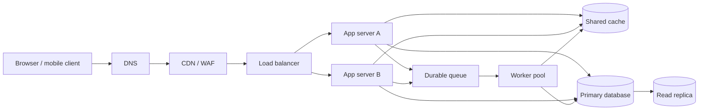

# QuickNotes service architecture

## Requirements

**Functional:** users can register and authenticate; create, read, update, and delete their own notes; attach and remove tags; search and paginate notes; and receive clear validation and authorization errors.

**Non-functional:** protect user data in transit and at rest; enforce tenant isolation; target 99.9% monthly availability; keep typical note reads under 300 ms at the 95th percentile; scale horizontally; back up data with point-in-time recovery; and emit metrics, traces, and audit-friendly logs without recording note bodies or credentials.

## Planning estimate for 1 million users

Assumptions: 1,000,000 registered users, 10% active daily (100,000 DAU), each active user makes 20 note reads and 2 writes per day, and a stored note averages 2 KiB including row/index overhead. Average rates are daily totals divided by 86,400 seconds; plan for a 10x peak multiplier.

| Measure | Estimate |
|---|---:|
| Reads | 2,000,000/day = 23.1 requests/second average; about 231/s peak |
| Writes | 200,000/day = 2.3 requests/second average; about 23/s peak |
| New storage | At 2 writes/day for 100,000 DAU and 2 KiB each: about 146 GB/year raw; plan about 300 GB/year with indexes, metadata, and growth headroom |

This is a sizing baseline, not a measured forecast. Backups and replicas add separate storage; retention, attachment support, and actual note sizes should be measured before capacity commitments.

## Architecture

**Component responsibilities:**

- **Client:** renders the notes experience and sends authenticated API requests.
- **DNS:** maps the service hostname to the edge entry point and supports endpoint changes.
- **CDN/WAF:** serves static assets near users and filters common malicious or abusive traffic.
- **Load balancer:** health-checks instances and distributes API requests across healthy app servers.
- **App servers A and B:** validate identity and input, enforce ownership, and implement the stateless API horizontally.
- **Shared cache:** reduces repeated reads and database load for hot data; cached entries are scoped by user and invalidated on writes.
- **Primary database:** provides durable transactional storage and authoritative writes.
- **Read replica:** serves eligible read traffic and provides a warm recovery target, with replication lag considered by callers.
- **Durable queue:** absorbs asynchronous work and retries it without blocking the user response.
- **Worker pool:** handles queued tasks such as notifications, cleanup, and search indexing independently of API latency.

## Request flows

**GET `/v1/notes`:** (1) DNS resolves the hostname to the CDN/WAF; (2) edge checks the request and forwards the API call to the load balancer; (3) the balancer chooses a healthy app server; (4) the server validates the token, validates cursor/filter parameters, and scopes the query to the user's ID; (5) it checks the cache, then reads from the replica when freshness policy permits or the primary otherwise; (6) it returns the page and opaque next cursor, and records metrics/traces.

**POST `/v1/notes`:** (1) the request reaches an app server through DNS, edge, and load balancer; (2) the server authenticates the user and validates title/body/tag ownership; (3) it inserts the note and tag links in one primary-database transaction; (4) it invalidates relevant cache keys and publishes follow-up work to the durable queue; (5) it returns `201 Created` with the saved note and `Location` header. Queue publication uses a transactional outbox so a committed note cannot silently lose its follow-up event.

## Trade-offs and availability

- **Replica reads improve read capacity but can be stale.** Read-after-write requests go to the primary (or use a consistency token); dashboards may tolerate short lag. The replica is monitored and can be rebuilt from the primary.
- **Caching lowers latency and database work but adds invalidation complexity.** Cache-aside is used only for safe, user-scoped reads, with bounded TTL and explicit invalidation after writes; a cache miss or outage falls back to the database.
- **Asynchronous work keeps note writes fast but introduces eventual completion and duplicate delivery.** Workers are idempotent, queue messages are retried with backoff and dead-letter handling, and the outbox closes the database/queue dual-write gap.
- **A single primary is simple and consistent but is a write bottleneck and failure risk.** Automated backups and point-in-time recovery, a monitored replica with documented promotion, and tested restore procedures reduce downtime and data-loss risk; the database remains a managed HA cluster across failure zones.

The CDN, load balancer, app tier, cache, queue, and database should run as managed or replicated services across availability zones. App servers are stateless and deployed in at least two instances; health checks drain unhealthy nodes. No single app server or worker is required for service. Database failover, queue durability, DNS health behavior, and backup restoration are exercised through regular recovery tests rather than assumed from diagrams alone.
